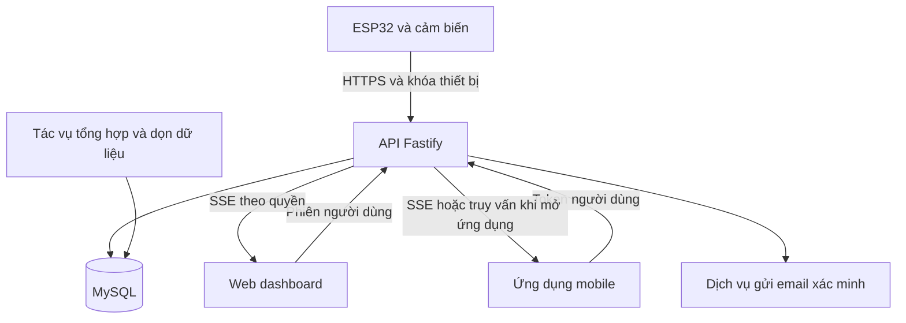

# Nền tảng IoT CTUT và ứng dụng Pepper Nursery

Tài liệu yêu cầu và thiết kế đề xuất — phiên bản 0.1

Ngày lập: 05/11/2026 • Đối tượng: nhóm phát triển 7 thành viên • Trạng thái: dự thảo để thống nhất trước triển khai.

Tài liệu này mô tả nền tảng nhận, lưu trữ và hiển thị dữ liệu IoT cho sinh viên CTUT, cùng thư viện Arduino dành cho ESP32. Pepper Nursery là ứng dụng đầu tiên dùng nền tảng để giám sát môi trường vườn ươm cây ớt. Mục tiêu là giúp nhóm triển khai song song trên một hợp đồng dữ liệu thống nhất và kiểm chứng khả năng phục vụ 50–100 thiết bị gửi mỗi 1–5 giây.

Tài liệu chưa phải xác nhận hệ thống đã được xây dựng, thử tải hoặc vận hành thành công. Nhà cung cấp máy chủ, cấu hình triển khai và chi phí được để mở theo yêu cầu. Các endpoint, hạn mức, thời hạn lưu, mục tiêu hiệu năng và lịch thực hiện dưới đây là đề xuất, cần nhóm phê duyệt và kiểm chứng.

## Mục lục

1. Bối cảnh và trạng thái quyết định
2. Mục tiêu và phạm vi MVP
3. Người dùng và các luồng sử dụng
4. Kiến trúc hệ thống
5. Tải dự kiến và giới hạn tài nguyên
6. Hợp đồng dữ liệu cảm biến
7. Thiết kế API
8. Mô hình dữ liệu MySQL
9. Lưu lịch sử và tổng hợp dữ liệu
10. Thư viện Arduino
11. Firmware và phần cứng Pepper Nursery
12. Web và ứng dụng mobile
13. Xác thực và bảo mật
14. Cảnh báo và quy tắc chăm sóc
15. Quan sát hệ thống và vận hành
16. Kiểm thử và tiêu chí nghiệm thu
17. Phân công nhóm
18. Lộ trình và quy trình Git
19. Rủi ro và quyết định còn mở
20. Bộ tài liệu bàn giao và tài liệu tham khảo

## 1. Bối cảnh và trạng thái quyết định

Dự án ban đầu có một ESP32 đọc cảm biến và truyền dữ liệu phục vụ giám sát cây ớt con. Người dùng nhận thấy độ trễ khi dùng ThingSpeak và muốn tự xây API, thư viện Arduino, đồng thời mở cho sinh viên CTUT sử dụng. Chưa có phép đo phân biệt độ trễ do chu kỳ gửi, mạng, giới hạn dịch vụ hay chu kỳ làm mới giao diện; cần đo từng đoạn thay vì giả định toàn bộ độ trễ đến từ một nguyên nhân.

| Nội dung | Trạng thái |
| --- | --- |
| Phục vụ học tập và dự án IoT của sinh viên CTUT | Yêu cầu của người dùng |
| 50–100 thiết bị hoạt động đồng thời | Quy mô mục tiêu, chưa kiểm chứng |
| Chu kỳ gửi 1–5 giây | Yêu cầu; cần tách khỏi chu kỳ đọc từng cảm biến |
| Xác minh bằng email sinh viên | Yêu cầu; tên miền chính xác cần xác nhận |
| Thư viện Arduino cho ESP32 | Yêu cầu; chưa có mã nguồn thư viện trong tài liệu này |
| MySQL | Công nghệ lưu trữ mong muốn; nơi vận hành để mở |
| TypeScript, Node.js và Fastify | Thiết kế đề xuất |
| HTTPS cho thiết bị, SSE cho giao diện | Thiết kế đề xuất cho MVP |
| Dữ liệu gốc 7 ngày, tổng hợp 5 phút giữ 90 ngày | Chính sách đề xuất, không phải hạn mức miễn phí của dịch vụ |
| MQTT, điều khiển tưới, OTA, hỗ trợ nhiều loại board | Hướng mở rộng, ngoài MVP |

Tên CTUT IoT là tên làm việc của dự án sinh viên, không mặc nhiên thể hiện đây là dịch vụ chính thức do trường bảo trợ. Pepper Nursery vẫn giữ nghiệp vụ riêng về cảm biến, hiệu chuẩn và chăm sóc cây ớt.

## 2. Mục tiêu và phạm vi MVP

### 2.1 Kết quả cần đạt

- Sinh viên xác minh email, tạo dự án và đăng ký thiết bị.
- ESP32 gửi một gói chứa nhiều thông số bằng thư viện có ví dụ sử dụng rõ ràng.
- Backend chỉ nhận dữ liệu của thiết bị có khóa hợp lệ, kiểm tra định dạng và lưu vào MySQL.
- Người có quyền xem giá trị mới nhất, biểu đồ lịch sử, trạng thái kết nối và xuất CSV.
- Dữ liệu hết hạn được dọn tự động sau khi tổng hợp thành công.
- Nhóm có báo cáo kiểm thử thực tế cho tải 50 và 100 thiết bị, ở chu kỳ 5 và 1 giây.

### 2.2 Chức năng trong MVP

| Mã | Chức năng | Điều kiện hoàn thành |
| --- | --- | --- |
| F01 | Đăng ký, xác minh email, đăng nhập, khôi phục mật khẩu | Email ngoài danh sách không được kích hoạt; liên kết xác minh chỉ dùng một lần |
| F02 | Quản lý dự án | Chủ dự án tạo và cấu hình danh sách thông số |
| F03 | Quản lý thiết bị và khóa | Cấp, thu hồi, thay khóa; khóa chỉ được hiển thị khi cấp |
| F04 | Nhận dữ liệu | Kiểm tra schema, loại trùng, ghi bền vững rồi mới xác nhận |
| F05 | Truy vấn và cập nhật giao diện | Lấy giá trị mới nhất, lịch sử có giới hạn, SSE theo quyền truy cập |
| F06 | Lưu trữ và CSV | Dọn dữ liệu theo chính sách; xuất dữ liệu có phân quyền |
| F07 | Giám sát cơ bản | Trạng thái thiết bị, lỗi truyền, số gói bị từ chối và tải API |
| F08 | Pepper Nursery | Hiển thị dữ liệu cảm biến và chất lượng đo; cảnh báo thử nghiệm trên giao diện |

### 2.3 Chức năng để sau MVP

Chưa triển khai tự động tưới hoặc bón phân, điều khiển thiết bị từ xa, MQTT broker, OTA, ứng dụng kéo thả dashboard, học máy, thanh toán, công khai dữ liệu, SSO chính thức của trường và chia sẻ dự án phức tạp. Mobile MVP ưu tiên màn hình giám sát; quản trị cấu hình tập trung trên web.

## 3. Người dùng và các luồng sử dụng

### 3.1 Quyền truy cập

| Chủ thể | Quyền dự kiến |
| --- | --- |
| Khách chưa đăng nhập | Xem hướng dẫn và biểu mẫu đăng ký |
| Sinh viên đã xác minh | Quản lý dự án, thiết bị và dữ liệu của mình trong hạn mức |
| Thiết bị | Chỉ gửi bản tin và đọc cấu hình tối thiểu của chính nó |
| Quản trị viên | Quản lý tài khoản, hạn mức và xử lý sự cố; truy cập dữ liệu cần ghi nhật ký |

MVP dùng mô hình một chủ sở hữu cho mỗi dự án. Nếu cần làm bài theo nhóm, bổ sung bảng thành viên dự án và vai trò owner/editor/viewer ở phiên bản sau; không chia sẻ mật khẩu tài khoản để thay thế phân quyền.

### 3.2 Luồng đưa thiết bị vào sử dụng

1. Sinh viên đăng ký bằng email thuộc tên miền cho phép.
2. Hệ thống gửi liên kết xác minh; chỉ kích hoạt sau khi người dùng mở liên kết hợp lệ.
3. Sinh viên tạo dự án, khai báo các trường đo và thêm thiết bị.
4. Backend cấp khóa thiết bị; sinh viên đưa khóa vào cấu hình riêng của sketch.
5. ESP32 kết nối Wi-Fi, đồng bộ giờ, đọc cảm biến và gửi dữ liệu.
6. Backend kiểm tra quyền, hạn mức và dữ liệu; lưu thành công rồi trả xác nhận.
7. Web/mobile hiển thị dữ liệu mới nhất và lịch sử của thiết bị được phép xem.

### 3.3 Các tình huống lỗi

- Mất Wi-Fi: cảm biến tiếp tục được đọc theo lịch; bản tin vào bộ đệm có giới hạn.
- Hết bộ đệm: bỏ bản tin cũ nhất và tăng bộ đếm mất dữ liệu; không ghi đè âm thầm.
- Gửi xong nhưng mất phản hồi: gửi lại đúng mã bản tin, backend không tạo dòng trùng.
- Khóa bị thu hồi: dừng thử gửi liên tục, báo lỗi cấu hình để người dùng xử lý.
- Lỗi cảm biến: gửi trạng thái lỗi và giá trị null, không thay bằng số 0.
- Email trường không còn truy cập được: xử lý phục hồi qua quy trình quản trị xác minh, không tự đổi sang email bất kỳ.

## 4. Kiến trúc hệ thống



Thiết kế đề xuất là một backend có các module tách biệt: auth, projects, devices, telemetry, queries, exports và administration. Fastify có khả năng kiểm tra request và định dạng response theo schema [1]; nhóm sẽ định nghĩa schema tĩnh trong mã nguồn, không cho sinh viên gửi schema thực thi tùy ý.

Thiết bị không kết nối MySQL trực tiếp. Các giao diện và thư viện chỉ biết API công khai; nơi triển khai backend có thể đổi mà không thay đổi nghiệp vụ. Tác vụ nền có thể chạy trong một tiến trình riêng nhưng dùng chung codebase; phải có khóa tránh hai tác vụ tổng hợp cùng chạy.

HTTPS được chọn để giảm số thành phần cần vận hành trong MVP. MQTT có thể bổ sung bằng một lớp nhận dữ liệu khác, tái sử dụng kiểm tra quyền và lưu trữ. Không triển khai cả hai giao thức ngay từ đầu nếu chưa có yêu cầu bắt buộc.

## 5. Tải dự kiến và giới hạn tài nguyên

### 5.1 Số bản tin

Công thức: số bản tin/giây = số thiết bị / chu kỳ gửi; số bản tin/ngày = số bản tin/giây × 86.400. Một bản tin chứa nhiều thông số, không phải mỗi thông số là một request riêng.

| Thiết bị | Chu kỳ | Bản tin mỗi giây | Bản tin mỗi ngày |
| --- | ---: | ---: | ---: |
| 50 | 5 giây | 10 | 864.000 |
| 100 | 5 giây | 20 | 1.728.000 |
| 50 | 1 giây | 50 | 4.320.000 |
| 100 | 1 giây | 100 | 8.640.000 |

Nếu tạm giả định một bản tin chiếm trung bình 500 byte dữ liệu lưu, 100 thiết bị tạo khoảng 0,864 GB/ngày ở chu kỳ 5 giây và 4,32 GB/ngày ở chu kỳ 1 giây. Bảy ngày tương ứng khoảng 6,048 GB và 30,24 GB theo đơn vị GB thập phân. Đây chỉ là phép ước lượng dữ liệu cơ sở: JSON thực tế có thể lớn hơn; index, metadata, binlog, bản sao lưu và dữ liệu tổng hợp đều cần thêm chỗ. Đo kích thước thực tế trên tập dữ liệu đại diện trước khi chốt dung lượng.

### 5.2 Hạn mức khởi đầu đề xuất

| Hạng mục | Đề xuất |
| --- | --- |
| Chu kỳ mặc định | 5 giây; người dùng được cấu hình 1–5 giây trong ngân sách chung |
| Thiết bị mỗi sinh viên | 2 thiết bị hoạt động; quản trị viên có thể điều chỉnh |
| Tổng thiết bị hoạt động trong thử nghiệm | Tối đa 100, kiểm tra khi kích hoạt thiết bị |
| Trường đo mỗi dự án | Tối đa 16 trường số |
| Kích thước request nhận dữ liệu | Tối đa 8 KiB |
| Tốc độ theo thiết bị | Trung bình tối đa 1 request/giây, cho phép burst 5 request |
| Lịch sử mỗi trang | Tối đa 1.000 dòng, dùng cursor |
| CSV đồng bộ | Tối đa 100.000 dòng mỗi lần; lớn hơn chuyển sang tác vụ nền sau MVP |
| SSE | Tối đa 2 kết nối/tài khoản; một kết nối nhận nhiều thiết bị được phép |

Hạn mức trên là cấu hình dự án, không phải năng lực đã chứng minh. Cần bổ sung giới hạn tổng, theo tài khoản và theo IP; tránh dùng IP làm giới hạn duy nhất vì nhiều sinh viên có thể cùng mạng trường. Khi bộ đệm server đầy hoặc DB không đáp ứng, trả lỗi có kiểm soát thay vì nhận vô hạn.

### 5.3 Mục tiêu hiệu năng để thử nghiệm

Đề xuất p95 thời gian API nhận và commit dữ liệu dưới 500 ms trong môi trường thử xác định; p95 từ lúc bắt đầu gửi đến lúc web hiển thị dưới 2 giây khi mạng bình thường. Thời gian chờ đến chu kỳ gửi kế tiếp phải được đo riêng: gửi mỗi 5 giây không có nghĩa một thay đổi ngoài đời luôn xuất hiện trong 2 giây. Đây là mục tiêu nghiệm thu, không phải SLA hoặc cam kết miễn phí không có độ trễ.

## 6. Hợp đồng dữ liệu cảm biến

### 6.1 Khai báo trường đo

Mỗi dự án có danh sách trường được quản lý trước: key, tên hiển thị, đơn vị, kiểu dữ liệu, yêu cầu hiệu chuẩn và giới hạn hợp lý tùy chọn. MVP chỉ hỗ trợ giá trị số hoặc null; bổ sung chuỗi, tọa độ và trạng thái nhị phân ở phiên bản sau. Key dùng chữ thường, số và dấu gạch dưới, dài tối đa 40 ký tự. Không dùng tên hiển thị tiếng Việt làm key API.

Mỗi lần thay đổi tập trường hoặc đơn vị tạo một revision bất biến. Dữ liệu mang revision tương ứng; nếu đổi đơn vị thì phải có revision mới và không gộp hai đơn vị vào cùng biểu đồ mà không chuyển đổi rõ ràng.

### 6.2 Ví dụ bản tin

```json
{
  "schema_version": 1,
  "metrics_revision": 1,
  "message_id": "a24f6943-2dc4-4baa-b021-9d6e252d8b51",
  "measured_at": "2026-11-05T08:00:00.000Z",
  "time_quality": "synced",
  "uptime_ms": 125000,
  "values": {
    "air_temperature": 29.5,
    "air_humidity": 75.0,
    "soil_moisture": 62.0,
    "solution_temperature": 27.6,
    "ph": null,
    "ph_voltage": 2.48,
    "tds": null
  },
  "quality": {
    "air_temperature": "valid",
    "air_humidity": "valid",
    "soil_moisture": "valid",
    "solution_temperature": "valid",
    "ph": "uncalibrated",
    "ph_voltage": "valid",
    "tds": "uncalibrated"
  },
  "calibration_revision": "pepper-cal-001",
  "firmware_version": "0.1.0"
}
```

Ví dụ chỉ minh họa định dạng, không phải kết quả đo thực. Backend suy ra device_id từ khóa, không tin một device_id tự khai trong payload.

### 6.3 Quy tắc xử lý

- schema_version là phiên bản hợp đồng; metrics_revision xác định tập trường và đơn vị của dự án.
- message_id được tạo một lần cho mỗi bản tin và giữ nguyên khi retry. Tính duy nhất xét trong từng thiết bị.
- measured_at là thời điểm đo UTC; received_at do server ghi khi tiếp nhận. Thiết bị chưa đồng bộ giờ gửi measured_at null và time_quality unsynced; không tự gán thời gian giả.
- Nếu synced, thời gian không được ở tương lai quá 5 phút hoặc cũ hơn 24 giờ so với server. Ngoài cửa sổ trả lỗi để firmware xử lý; cửa sổ này là chính sách đề xuất.
- effective_at dùng measured_at hợp lệ, nếu không có thì dùng received_at và giữ dấu hiệu thời gian không đồng bộ cho giao diện.
- Mỗi key có trong values phải có quality. valid đi kèm số hữu hạn; uncalibrated, sensor_error hoặc stale đi kèm null. Không gửi NaN/Infinity vì JSON không hỗ trợ.
- Trường thiếu nghĩa là chưa gửi thông số đó, không phải bằng 0. Trường ngoài revision khai báo bị từ chối. Phải có ít nhất một trường đo.
- Quy tắc giới hạn vật lý có thể đánh dấu out_of_range và giữ giá trị số để điều tra; không đưa mẫu này vào tính trung bình hợp lệ.
- Kiểm tra toàn bộ gói trước khi lưu; không lưu một phần rồi báo thành công toàn bộ.
- Backend không tự chứng nhận hiệu chuẩn chỉ vì thiết bị gửi quality valid. Pepper Nursery cần hồ sơ hiệu chuẩn liên kết với calibration_revision để người xem kiểm tra.

## 7. Thiết kế API

Tiền tố /api/v1. JSON UTF-8; thời gian UTC ISO 8601. Thiết bị dùng Authorization: Bearer DEVICE_TOKEN. Web dùng cookie phiên bảo mật; mobile dùng token người dùng riêng. Không dùng khóa thiết bị để gọi API quản trị dự án.

### 7.1 Các endpoint đề xuất

| Phương thức và đường dẫn | Chủ thể | Mục đích |
| --- | --- | --- |
| POST /auth/register | Khách | Đăng ký email và mật khẩu |
| POST /auth/verify-email | Khách có mã | Xác minh email |
| POST /auth/login | Khách | Tạo phiên hoặc token người dùng |
| POST /auth/logout | Người dùng | Thu hồi phiên |
| POST /auth/password-reset/request | Khách | Yêu cầu liên kết đổi mật khẩu |
| POST /auth/password-reset/confirm | Khách có mã | Đặt mật khẩu mới |
| POST /auth/refresh | Mobile có refresh token | Đổi token và xoay refresh token |
| GET /me | Người dùng | Thông tin tài khoản và hạn mức |
| GET, POST /projects | Người dùng | Danh sách và tạo dự án |
| GET, PATCH /projects/{id} | Chủ dự án | Xem và chỉnh metadata |
| POST /projects/{id}/metric-revisions | Chủ dự án | Tạo tập trường mới bất biến |
| GET, POST /projects/{id}/devices | Chủ dự án | Danh sách và thêm thiết bị |
| PATCH /devices/{id} | Chủ dự án | Đổi tên, bật/tắt, cấu hình chu kỳ |
| POST /devices/{id}/tokens | Chủ dự án | Cấp hoặc thay khóa |
| DELETE /devices/{id}/tokens/{tokenId} | Chủ dự án | Thu hồi khóa |
| GET /device/config | Thiết bị | Lấy chu kỳ gửi và revision hiện hành |
| POST /telemetry | Thiết bị | Gửi một bản tin |
| GET /devices/{id}/latest | Chủ dự án | Trạng thái mới nhất theo từng trường |
| GET /devices/{id}/readings | Chủ dự án | Lịch sử gốc có cursor |
| GET /devices/{id}/aggregates | Chủ dự án | Lịch sử tổng hợp |
| GET /devices/{id}/export | Chủ dự án | Xuất CSV trong giới hạn |
| GET /events | Người dùng | Luồng SSE đã lọc theo quyền |

Các đường dẫn trong bảng được ghép sau /api/v1. Xóa vĩnh viễn dự án và dữ liệu cần luồng riêng có xác nhận; MVP ưu tiên vô hiệu hóa thiết bị và lưu trạng thái deleted_at để tránh xóa nhầm trong thử nghiệm.

### 7.2 Phản hồi và chống trùng

```json
{
  "data": {
    "message_id": "a24f6943-2dc4-4baa-b021-9d6e252d8b51",
    "accepted": true,
    "duplicate": false,
    "received_at": "2026-11-05T08:00:00.180Z"
  },
  "request_id": "req_example_001"
}
```

Trả 201 khi transaction ghi mới đã commit. Cùng device_id và message_id, cùng nội dung nghiệp vụ trả 200 với duplicate true, không tăng số mẫu tổng hợp lần nữa. Nếu cùng mã nhưng nội dung khác, trả 409. Backend tính payload_hash trên biểu diễn chuẩn hóa các trường nghiệp vụ; không dựa vào thứ tự key trong JSON hoặc whitespace. Dữ liệu gốc còn lưu ít nhất 7 ngày, dài hơn cửa sổ chấp nhận gửi muộn 24 giờ.

Trả thành công nghĩa là đã lưu vào cơ sở dữ liệu theo cấu hình độ bền đã kiểm tra. Khi DB lỗi, trả 503; không trả 201 chỉ vì đã giữ bản tin trong RAM. Phát sự kiện SSE sau commit. Nếu phát SSE thất bại, dữ liệu vẫn tồn tại và client tải lại qua API.

```json
{
  "error": {
    "code": "RATE_LIMITED",
    "message": "Too many telemetry requests",
    "retry_after_seconds": 3
  },
  "request_id": "req_example_002"
}
```

| HTTP | Ý nghĩa | Hành vi firmware |
| --- | --- | --- |
| 200 hoặc 201 | Đã lưu hoặc bản tin trùng đã có | Xóa bản tin khỏi hàng đợi |
| 400 hoặc 422 | Sai JSON, schema hoặc giá trị | Loại khỏi hàng đợi, ghi lỗi; không retry vô hạn |
| 401 hoặc 403 | Sai khóa, thu hồi, vô hiệu hóa | Tạm dừng gửi, yêu cầu sửa cấu hình |
| 409 | Mã bản tin trùng nhưng nội dung khác | Ghi lỗi lập trình, không tạo lại mã để che lỗi |
| 413 | Gói quá lớn | Giảm số trường hoặc sửa payload |
| 429 | Vượt hạn mức | Tuân thủ Retry-After |
| 500 hoặc 503, timeout | Lỗi tạm thời | Retry cùng message_id với backoff và jitter |

Lịch sử nhận from, to, cursor, limit và danh sách key; thứ tự ổn định theo effective_at và id. response chứa next_cursor. Endpoint tổng hợp nhận độ phân giải 5m hoặc 1h; giá trị trung bình 1h phải tính từ tổng và số mẫu, không lấy trung bình đơn giản của các trung bình 5 phút.

## 8. Mô hình dữ liệu MySQL

### 8.1 Các bảng chính

| Bảng | Nội dung và ràng buộc quan trọng |
| --- | --- |
| users | id, email duy nhất, password_hash, email_verified_at, role, status |
| verification_tokens | user_id, token_hash, mục đích, expires_at, used_at |
| user_sessions | user_id, token_hash, loại web/mobile, thời hạn, revoked_at |
| projects | id, owner_id, name, description, current_metrics_revision |
| metric_revisions | project_id, revision, danh sách trường bất biến, created_at; unique project và revision |
| devices | id, project_id, name, status, interval_seconds, last_seen_at, deleted_at |
| device_tokens | id, device_id, token_hash, created_at, revoked_at, last_used_at |
| calibration_records | device_id, revision, sensor_key, phương pháp, điểm chuẩn, hệ số, thời gian, người thực hiện |
| readings | id BIGINT, device_id, message_id, measured_at, received_at, effective_at, time_quality, metrics_revision, calibration_revision, values_json, quality_json, payload_hash |
| device_latest | device_id, metric_key, metrics_revision, value, quality, effective_at, reading_id; giữ một bản mới nhất mỗi trường |
| aggregates_5m | device_id, metric_key, metrics_revision, bucket_start, valid_count, invalid_count, value_sum, value_min, value_max |
| audit_logs | actor_id, action, target_id, result, request_id, created_at; không ghi secret |
| job_runs | tên tác vụ, khóa chạy, watermark, thời gian, kết quả và lỗi |

Thiết kế raw readings dùng một dòng cho một bản tin, các giá trị biến đổi nằm trong JSON. MySQL có kiểu JSON; không giả định mọi trường bên trong JSON tự có index [5]. Nếu truy vấn một trường cụ thể trở thành điểm nghẽn, nhóm cân nhắc generated column hoặc bảng giá trị riêng sau khi đo.

### 8.2 Index và truy vấn

- UNIQUE(device_id, message_id) cho chống trùng.
- INDEX(device_id, effective_at, id) cho lịch sử theo thời gian.
- INDEX(received_at, id) cho tác vụ dọn dữ liệu theo lô.
- UNIQUE(device_id, metric_key, metrics_revision, bucket_start) trên bảng tổng hợp.
- Index owner_id và project_id cho kiểm tra quyền theo quan hệ user → project → device.

Ngày giờ lưu theo UTC với độ chính xác mili giây. Dùng truy vấn tham số hóa; không nối trực tiếp key hoặc điều kiện do client nhập vào SQL. Nếu một câu SQL cần tên cột động, ánh xạ qua danh sách cho phép trong code.

### 8.3 Tính nhất quán

Trong transaction nhận bản tin: xác nhận thiết bị hợp lệ, insert readings và cập nhật device_latest chỉ khi bản mới có effective_at mới hơn. Một bản tin gửi bù cũ không được làm giá trị mới nhất lùi lại. Theo dõi last_seen_at bằng thời gian server nhận được giao tiếp hợp lệ, không dùng measured_at.

Khi quality của mẫu mới là lỗi, trạng thái hiện tại phải là lỗi. Nếu hiển thị thêm giá trị hợp lệ gần nhất, phải ghi rõ thời điểm và nhãn dữ liệu cũ; không dùng nó làm giá trị hiện tại.

## 9. Lưu lịch sử và tổng hợp dữ liệu

### 9.1 Chính sách đề xuất

| Loại dữ liệu | Cách giữ |
| --- | --- |
| Bản tin gốc | 7 ngày tính từ received_at |
| Tổng hợp 5 phút | 90 ngày theo bucket_start |
| device_latest | Giữ khi thiết bị còn tồn tại; giao diện luôn hiện tuổi dữ liệu |
| Hồ sơ hiệu chuẩn | Giữ cùng thiết bị và các dữ liệu còn tham chiếu |
| Nhật ký bảo mật | Đề xuất 30 ngày, cấu hình riêng |
| CSV người dùng tải xuống | Người dùng tự quản lý; không coi là bản sao lưu hệ thống |

### 9.2 Quy trình tổng hợp

Bucket chia theo UTC: floor(effective_at / 300 giây) × 300 giây. Tính riêng cho từng thiết bị, key và metrics_revision. Chỉ quality valid có số hữu hạn được tính vào valid_count, sum, min, max. Mẫu lỗi được tính invalid_count, không thay bằng 0.

Đề xuất tác vụ chạy mỗi phút, đọc bản tin mới theo watermark received_at và id, đánh dấu bucket bị ảnh hưởng rồi tính lại bucket từ raw readings bằng phép upsert thay thế kết quả. Khi có bản tin gửi muộn, bucket lịch sử tương ứng được tính lại. Watermark chỉ tăng sau khi ghi thành công; chạy lại không cộng hai lần. Phải thử tình huống tiến trình dừng giữa chừng và nhiều bản tin có cùng timestamp.

Tác vụ dọn chạy theo lô nhỏ, chỉ xóa raw readings đã quá 7 ngày và được bao phủ bởi tổng hợp hoàn tất. Dữ liệu tổng hợp hết 90 ngày được xóa riêng. Nếu tổng hợp bị lỗi, tạm ngừng dọn raw và phát cảnh báo; không xóa để đạt dung lượng bằng mọi giá.

Trong 5 phút có tối đa 300 mẫu nếu gửi 1 giây, hoặc 60 mẫu nếu gửi 5 giây, cho mỗi trường gửi đều. valid_count thấp có thể do mất kết nối, trường không được gửi hoặc mẫu lỗi; không tự suy ra một nguyên nhân duy nhất.

### 9.3 Xuất và sao lưu

CSV gồm device_id, message_id, measured_at, received_at, time_quality, giá trị và quality từng trường, đơn vị và revision. Giới hạn khoảng thời gian, số dòng và số tác vụ đồng thời; ghi dữ liệu theo luồng để không tải hết vào RAM. Phòng ngừa công thức CSV từ các trường văn bản do người dùng đặt.

Đề xuất sao lưu hằng ngày và diễn tập khôi phục trước mở rộng thử nghiệm. Mục tiêu phục hồi ban đầu: mất tối đa 24 giờ dữ liệu theo lịch backup và khôi phục trong 4 giờ khi có môi trường phù hợp. Đây là mục tiêu cần đo; nơi lưu backup ngoài máy chính còn để mở. Retention không thay thế backup.

## 10. Thư viện Arduino

Tên làm việc: CTUTIoT. Ngôn ngữ: C++. Nền tảng đầu tiên: Arduino framework trên ESP32. Cấu trúc theo đặc tả Arduino [2]: library.properties, thư mục src, examples và tài liệu sử dụng.

### 10.1 API thư viện dự kiến

```cpp
// Thiết kế giao diện dự kiến, chưa phải mã có thể biên dịch.
CTUTIoTClient iot;

void setup() {
  // Ứng dụng kết nối Wi-Fi và chuẩn bị thời gian trước.
  iot.begin(API_URL, DEVICE_TOKEN);
  iot.setMetricsRevision(1);
  iot.setSendInterval(5000);
}

void loop() {
  iot.loop();
  if (samplingDue()) {
    iot.beginReading();
    iot.set("air_temperature", temperature);
    iot.set("air_humidity", humidity);
    iot.setInvalid("ph", "uncalibrated");
    iot.enqueue();
  }
}
```

samplingDue, temperature và humidity do sketch ứng dụng cung cấp. Thư viện không tự đọc mọi cảm biến; trách nhiệm đọc và hiệu chuẩn thuộc firmware của dự án. Mỗi beginReading tạo một tập giá trị mới, tránh mang giá trị cũ từ lần gửi trước. enqueue đóng băng payload và message_id cho đến khi gửi xong hoặc bị loại.

### 10.2 Hành vi cần triển khai

- Không dùng delay dài để quản lý chu kỳ; tách lịch đọc, lịch gửi và lịch retry.
- Chọn triển khai gửi trong tác vụ mạng riêng hoặc quy định timeout rõ ràng; không tuyên bố thư viện không chặn nếu vẫn gọi HTTP đồng bộ trong vòng đọc cảm biến.
- Backoff đề xuất 1, 2, 4, 8 đến 60 giây, thêm jitter; 429 ưu tiên Retry-After.
- Bộ đệm mặc định 10 bản tin, tổng giới hạn byte cấu hình và đo theo heap thực tế. Gói lớn bị từ chối trước khi xếp hàng.
- Khi đầy, bỏ bản cũ nhất; trả bộ đếm dropped_readings cho ứng dụng. RAM bị mất khi khởi động lại, nên MVP không cam kết giữ dữ liệu qua mất điện.
- Khi gửi bù, vẫn tuân thủ hạn mức; nếu tốc độ phát sinh bằng tốc độ gửi tối đa thì bộ đệm có thể không rút hết. Firmware phải thông báo mất dữ liệu, có thể tạm giảm tần suất lấy mẫu theo cấu hình được cho phép.
- Kiểm tra chứng chỉ TLS bằng CA tin cậy; không dùng chế độ bỏ xác minh trong bản phát hành.
- Không in khóa thiết bị vào Serial, log hoặc thông báo lỗi. Không đưa credentials thật vào examples.
- Công bố phiên bản ESP32 core đã thử nghiệm và phiên bản thư viện; chưa khẳng định hỗ trợ mọi board.

Ví dụ bàn giao: gửi dữ liệu giả lập; gửi DHT22; Pepper Nursery đầy đủ; mất mạng và retry; khóa sai; nhận lỗi hạn mức. Bản đầu phát hành dưới dạng ZIP để cài thử; đăng Arduino Library Manager là bước riêng sau khi đáp ứng yêu cầu phát hành.

## 11. Firmware và phần cứng Pepper Nursery

### 11.1 Vai trò linh kiện

| Linh kiện | Vai trò | Nội dung phải kiểm tra |
| --- | --- | --- |
| ESP32 DevKitC hoặc ESP-32D | Đọc cảm biến và truyền dữ liệu | Xác định đúng board và số chân thực |
| ESP32 30P Expansion Board | Phân phối nguồn và chân tín hiệu | Vị trí jumper, điện áp từng hàng, sơ đồ thực tế |
| DHT22 hoặc AM2302 | Nhiệt độ và độ ẩm không khí | Chu kỳ đọc đúng tài liệu cảm biến, trạng thái lỗi |
| HD-38 | Tín hiệu liên quan độ ẩm đất | Hiệu chuẩn khô/ướt trên giá thể thực; giá trị phần trăm là quy đổi của phương pháp |
| DS18B20 chống nước | Nhiệt độ mẫu hoặc dung dịch | Điện trở kéo lên trên module thực, CRC và lỗi đọc |
| TDS Meter V1.0 | Ước lượng TDS trong dung dịch | Hệ số quy đổi, nhiệt độ, dung dịch chuẩn và điện áp đầu ra |
| Module pH và điện cực composite | Đo pH dung dịch | Model thực; PH-4502C đang là giả định trong mô tả G0, phải đối chiếu phần cứng |

Không suy ra điện áp an toàn từ tên linh kiện hoặc jumper chung. Trước cấp nguồn, nhóm đối chiếu datasheet/module thực, đo điện áp đầu ra và xác nhận mức vào ADC của ESP32. Pin map và mạch bảo vệ là tài liệu phần cứng riêng, cần kiểm tra trên mạch thật; tài liệu này không thay thế sơ đồ đấu dây đã nghiệm thu.

### 11.2 Phạm vi khoa học của phép đo

TDS và pH trong MVP đo mẫu nước hoặc dung dịch. TDS không trực tiếp cho biết riêng hàm lượng N, P, K; không được gọi giá trị TDS là bộ đo đầy đủ dinh dưỡng đất. Nếu lấy mẫu chiết đất, phải mô tả phương pháp lấy mẫu, tỷ lệ đất/nước và thời gian xử lý để so sánh được kết quả.

Hồ sơ pH ghi dung dịch chuẩn, nhiệt độ, điện áp tại từng điểm, hệ số tính và thời điểm hiệu chuẩn. Hồ sơ HD-38 ghi giá thể, điểm khô/ướt và công thức quy đổi. Hồ sơ TDS ghi chuẩn tham chiếu, nhiệt độ và phương pháp bù nhiệt. Chưa đủ hồ sơ thì giữ trạng thái uncalibrated; có thể hiển thị điện áp thô như một trường riêng đã gắn đơn vị.

Chu kỳ truyền 1 giây không có nghĩa tất cả cảm biến cung cấp mẫu mới mỗi giây. Firmware tuân thủ chu kỳ đọc hợp lệ của từng thiết bị; khi gửi lặp giá trị cũ cần ghi nhận độ mới hoặc chỉ gửi trường vừa cập nhật. Không đưa mẫu lặp do phần mềm thành bằng chứng có nhiều phép đo độc lập.

## 12. Web và ứng dụng mobile

### 12.1 Các màn hình MVP

| Màn hình | Nội dung |
| --- | --- |
| Đăng nhập và xác minh | Trạng thái xác minh, gửi lại có giới hạn, khôi phục mật khẩu |
| Danh sách dự án | Dự án của người dùng, số thiết bị, lần cập nhật cuối |
| Chi tiết thiết bị | Giá trị, đơn vị, chất lượng, thời điểm đo, trạng thái kết nối |
| Lịch sử | Bộ lọc thời gian và trường đo; lựa chọn raw hoặc aggregate |
| Cấu hình | Tên thiết bị, chu kỳ, tập trường; cấp lại khóa có xác nhận |
| Xuất CSV | Khoảng dữ liệu, giới hạn và thời hạn còn lưu |
| Quản trị | Tài khoản, thiết bị hoạt động, số request lỗi và dung lượng |

Web và mobile dùng cùng định nghĩa đơn vị, mã lỗi và trạng thái. Mobile MVP hiển thị dữ liệu và lịch sử; không bắt buộc giám sát nền khi ứng dụng đóng. Framework giao diện và hệ thống thiết kế cần thống nhất với nhóm, chưa khóa trong bản này.

### 12.2 Cập nhật và trạng thái kết nối

SSE dùng luồng text/event-stream; EventSource duy trì kết nối nhận sự kiện từ server [4]. Web cùng origin dùng cookie phiên HttpOnly. Không đặt token dài hạn vào query string. Khi phiên hết hạn hoặc quyền thay đổi, server đóng luồng; mọi lần kết nối lại phải xác thực lại.

Giao diện tải snapshot trước, sau đó nhận cập nhật; dùng reading_id/thời điểm để không ghi đè dữ liệu mới bằng dữ liệu cũ. Khi nối lại SSE, tải lại latest và khoảng lịch sử bị thiếu. MVP không coi SSE là hàng đợi bền vững đảm bảo phát lại mọi sự kiện. Một kết nối nhận nhiều thiết bị; không mở một kết nối cho mỗi ô biểu đồ.

Đề xuất offline khi không có giao tiếp hợp lệ trong max(3 × chu kỳ gửi, 30 giây). Đây là quy ước hiển thị; không chứng minh thiết bị đã mất nguồn. Kết nối SSE mất cần hiển thị trạng thái kết nối của dashboard riêng với trạng thái ESP32.

## 13. Xác thực và bảo mật

### 13.1 Email sinh viên

Tên miền cho phép nằm trong cấu hình và phải được xác nhận trước phát hành. Parse địa chỉ email, so sánh domain chính xác; không dùng phép kiểm tra chuỗi chứa tên trường. Token xác minh là chuỗi ngẫu nhiên đủ mạnh, chỉ lưu hash, hết hạn đề xuất sau 30 phút và chỉ dùng một lần. Giới hạn gửi lại theo tài khoản/IP, phản hồi khôi phục mật khẩu không tiết lộ email có tồn tại.

Xác minh email chứng minh người dùng kiểm soát hộp thư lúc xác minh, không tự chứng minh đang theo học. Nếu cần xác nhận sinh viên còn học, phải có quy trình bổ sung hoặc tích hợp chính thức với trường. Dịch vụ gửi thư, hạn mức và khả năng thư tới inbox phải được kiểm thử; tài khoản thử nghiệm có thể được quản trị viên duyệt thủ công, nhưng không được ghi là đã xác minh email thật.

### 13.2 Người dùng và thiết bị

Mật khẩu dùng thuật toán hash chuyên dụng qua thư viện đã được kiểm tra; không lưu rõ hoặc mã hóa có thể giải ngược. Phiên web dùng cookie Secure, HttpOnly, SameSite phù hợp và chống CSRF cho thao tác thay đổi dữ liệu. Mobile lưu token bằng cơ chế lưu trữ bảo mật của hệ điều hành; refresh token có thể thu hồi và xoay vòng.

Khóa thiết bị dùng ngẫu nhiên mật mã, chỉ hiển thị lúc cấp và chỉ lưu hash phía server. Thu hồi phải tác động ngay hoặc trong cửa sổ cache được quy định và kiểm thử. Khi thay khóa, có thể cho phép chồng lấn tối đa 10 phút để cập nhật thiết bị, sau đó thu hồi khóa cũ; mặc định không giữ khóa cũ vô thời hạn.

### 13.3 Kiểm soát bắt buộc

- HTTPS cho API công khai và kiểm tra quyền trên từng endpoint theo hướng dẫn REST của OWASP [3].
- Kiểm tra quyền trên đối tượng cụ thể, không chỉ kiểm tra đã đăng nhập. Đổi device_id trong URL không được truy cập thiết bị người khác [6].
- CORS chỉ cho origin hợp lệ; CORS không thay thế xác thực và phân quyền.
- Rate limit, giới hạn kích thước JSON, giới hạn query và timeout DB.
- Không trả stack trace hoặc SQL nội bộ cho client; có request_id để tra cứu.
- Quét secret trước merge; dùng file cấu hình mẫu không chứa khóa thật.
- Audit thao tác cấp/thu hồi khóa, thay hạn mức, vô hiệu hóa tài khoản và truy cập quản trị.
- Dữ liệu riêng tư mặc định; không hiển thị email sinh viên trên dashboard công khai.

## 14. Cảnh báo và quy tắc chăm sóc

MVP đưa ra cảnh báo tham khảo trên giao diện, chưa điều khiển tưới/bón. Ngưỡng chăm sóc do MThuy đề xuất kèm nguồn phù hợp giống ớt, tuổi cây, giá thể và điều kiện vườn; tài liệu này không tự đặt ngưỡng nông học để đưa vào vận hành.

Mỗi quy tắc gồm trường đo, điều kiện, ngưỡng, thời gian kéo dài, độ trễ phục hồi và mức ưu tiên. Chỉ dùng mẫu valid và còn mới. Đề xuất chống lặp bằng trạng thái normal → pending → active → recovered; ghi nhận sự kiện khi chuyển trạng thái, không tạo cảnh báo mới mỗi giây. Mẫu lỗi hoặc mất mạng tạo thông báo chất lượng dữ liệu riêng.

Ngưỡng có hai mức kích hoạt/phục hồi để tránh bật tắt liên tục quanh một giá trị. Bộ kiểm thử dùng ngưỡng giả lập được ghi rõ, không trình bày chúng như hướng dẫn chăm sóc cây ớt đã được thẩm định.

## 15. Quan sát hệ thống và vận hành

Theo dõi tối thiểu: số request/giây, p50/p95/p99 độ trễ, lỗi theo mã, số bản tin mới/trùng/bị từ chối, kết nối DB đang dùng, thời gian truy vấn, heap/RAM, dung lượng bảng/index, tuổi bản sao lưu, độ trễ tác vụ tổng hợp và số kết nối SSE.

Log có timestamp UTC, request_id và mã thiết bị; che Authorization, cookie, mật khẩu và token xác minh. Không log toàn bộ payload mặc định. Đề xuất cảnh báo nội bộ khi DB lỗi kéo dài, dung lượng vượt 80%, tổng hợp chậm trên 15 phút hoặc backup quá 24 giờ; hiệu chỉnh theo đo thực tế.

Kịch bản sự cố cần tài liệu: DB không truy cập được; tác vụ tổng hợp lỗi; đĩa gần đầy; khóa bị lộ; email xác minh không đến; thiết bị gửi sai hàng loạt. Mỗi kịch bản nêu người phụ trách, cách phát hiện, thao tác giảm ảnh hưởng và cách xác minh phục hồi. Nhà cung cấp và lệnh triển khai cụ thể bổ sung sau khi chốt hạ tầng.

## 16. Kiểm thử và tiêu chí nghiệm thu

| Mã | Kịch bản | Kết quả mong đợi |
| --- | --- | --- |
| T01 | Email ngoài domain, mã hết hạn, dùng lại mã | Không kích hoạt tài khoản |
| T02 | Sinh viên A đổi ID để xem thiết bị B | Bị từ chối ở latest, lịch sử, CSV, cấu hình và SSE |
| T03 | Gửi gói hợp lệ | Đúng một dòng raw, latest đúng, phản hồi sau commit |
| T04 | Gửi lại gói sau timeout | Không nhân đôi raw hoặc số mẫu tổng hợp |
| T05 | Cùng message_id, khác payload | 409, dữ liệu cũ không bị sửa |
| T06 | null, sai kiểu, key lạ, gói quá lớn | Xử lý đúng quy tắc và mã lỗi |
| T07 | pH/TDS chưa hiệu chuẩn | Không hiển thị số quy đổi như giá trị hợp lệ |
| T08 | Mất Wi-Fi 2 phút rồi khôi phục | Retry có giới hạn; số mẫu bỏ được báo đúng |
| T09 | Khởi động lại ESP32 | Không tái dùng mã bản tin; công khai giới hạn mất bộ đệm RAM |
| T10 | Thu hồi khóa khi đang gửi | Ngừng nhận theo cửa sổ thu hồi đã quy định |
| T11 | DB dừng hoặc transaction lỗi | Không trả thành công giả; retry sau phục hồi không trùng |
| T12 | Dữ liệu đến sai thứ tự và gửi muộn | latest không lùi; bucket lịch sử được tính lại |
| T13 | Tác vụ dừng giữa chừng rồi chạy lại | Không tăng gấp đôi tổng hợp; watermark an toàn |
| T14 | Raw đủ hạn nhưng chưa tổng hợp | Chưa xóa và có cảnh báo |
| T15 | Tổng hợp giờ có số mẫu mỗi bucket khác nhau | Trung bình có trọng số bằng sum/count |
| T16 | SSE đứt, phiên hết hạn và đổi quyền | Nối lại có xác thực, tải bù, không rò dữ liệu |
| T17 | Khôi phục backup vào DB sạch | Đếm và đối chiếu mẫu, quyền sở hữu và truy vấn thành công |
| T18 | Thử tải và export đồng thời | Báo cáo latency, lỗi, mất/trùng, RAM và DB; không suy diễn từ máy rảnh |

Thử tải tăng dần: 10 thiết bị → 50 → 100 ở chu kỳ 5 giây, sau đó 1 giây. Chạy mỗi cấu hình ổn định ít nhất 30 phút; cấu hình mục tiêu chạy thêm 2 giờ cùng 20 phiên dashboard giả lập và một tác vụ CSV giới hạn. Bổ sung burst kết nối lại và tổng hợp nền đang hoạt động.

Khi đối chiếu, tách mẫu tạo ra, mẫu bị bộ đệm bỏ, mẫu bị từ chối, mẫu đang chờ và mẫu đã được xác nhận. Mọi bản tin được xác nhận thành công phải truy vấn được sau khởi động lại backend, trừ dữ liệu đã hết hạn theo chính sách. Báo cáo phải ghi cấu hình máy, phiên bản phần mềm, kích thước payload, số trường, thời gian thử và vị trí máy phát tải.

Điều kiện mở pilot: các kiểm thử phân quyền, chống trùng, chất lượng cảm biến, khôi phục và retention đạt; không còn lỗi nghiêm trọng. Nếu cấu hình 100 thiết bị × 1 giây không đạt, giảm hạn mức thử nghiệm hoặc tối ưu và đo lại, không công bố đã hỗ trợ chỉ dựa trên phép tính request/giây.

## 17. Phân công nhóm

Đề xuất mở rộng từ phân công ban đầu; không coi là thay đổi đã được tất cả thành viên chấp thuận.

| Thành viên | Trách nhiệm chính | Đầu ra và điểm phối hợp |
| --- | --- | --- |
| TKiet | Kiến trúc, phần cứng, tích hợp | Chốt contract, quyết định kỹ thuật, kiểm tra mạch, tích hợp end-to-end và nghiệm thu |
| QTien | Đọc cảm biến, chất lượng và hiệu chuẩn | Module cảm biến, hồ sơ hiệu chuẩn, dữ liệu thực; thống nhất interface với TVan |
| TVan | Mạng ESP32 và thư viện CTUTIoT | HTTPS, bộ đệm, retry, ví dụ, báo lỗi; phối hợp TDat về mã lỗi và chống trùng |
| TDat | Backend, API và MySQL | Auth, phân quyền, schema DB, telemetry, tổng hợp, retention, CSV và log |
| DKhoa | Web dashboard | Tài khoản, cấu hình dự án/thiết bị, dữ liệu trực tiếp, biểu đồ và CSV |
| QThang | Mobile | Đăng nhập, giám sát, lịch sử, trạng thái offline; dùng chung contract |
| MThuy | Quy tắc chăm sóc và QA | Nguồn ngưỡng, bộ dữ liệu thử, ma trận kiểm thử, kiểm tra mất/trùng và báo cáo |

Backend có nhiều hạng mục nhất. TKiet cần hỗ trợ tích hợp và review contract; DKhoa/QThang triển khai bằng mock server trước; TVan có sketch giả lập để không chờ cảm biến. Nếu thiếu thời gian, cắt quản trị nâng cao và cảnh báo trước khi cắt phân quyền, xác thực hoặc kiểm tra dữ liệu.

## 18. Lộ trình và quy trình Git

### 18.1 Các giai đoạn đề xuất

| Giai đoạn | Đầu ra | Cổng nghiệm thu |
| --- | --- | --- |
| G0 — thống nhất, khoảng 1 tuần | Phạm vi, contract, API, mô hình DB, pin map và dữ liệu mẫu | Nhóm ký xác nhận; schema mẫu nhất quán |
| G1 — luồng dữ liệu, khoảng 1 tuần | ESP32 giả lập → API → MySQL → web tối thiểu | Gửi và xem được; retry không trùng |
| G2 — tài khoản, khoảng 1 tuần | Email, dự án, thiết bị, khóa, quyền sở hữu | T01, T02, T10 đạt |
| G3 — thư viện và cảm biến, 1–2 tuần | SDK, firmware thật, hiệu chuẩn và mobile cơ bản | Trạng thái đo chính xác; có thử mất mạng |
| G4 — lịch sử và độ tin cậy, khoảng 1 tuần | SSE, tổng hợp, retention, CSV, backup | T11–T17 đạt |
| G5 — thử tải và pilot, khoảng 1 tuần | Báo cáo tải, hướng dẫn, sửa lỗi | T18 đạt trong cấu hình công bố |

Tổng ước lượng 6–7 tuần với công việc song song, phụ thuộc năng lực và thời gian nhóm; chưa phải lịch cam kết. Đo hiệu năng sớm từ G1 để tránh dồn mọi rủi ro sang G5.

### 18.2 Tổ chức repository

| Đường dẫn đề xuất | Nội dung |
| --- | --- |
| firmware/sensors/ | Driver và xử lý dữ liệu cảm biến Pepper Nursery |
| firmware/network/ | Tích hợp thư viện, cấu hình và hàng đợi của ứng dụng |
| libraries/CTUTIoT/ | Thư viện Arduino có src, examples, library.properties |
| backend/ | Các module API, migration, tác vụ nền và kiểm thử |
| web/ | Web dashboard |
| mobile/ | Ứng dụng mobile |
| docs/contracts/ | OpenAPI, schema JSON, payload và mã lỗi |
| docs/architecture/ | Phạm vi, kiến trúc, nhật ký quyết định |
| docs/hardware/ | Pin map, nguồn, điện áp, biên bản kiểm tra |
| docs/agronomy/ | Nguồn ngưỡng, hồ sơ hiệu chuẩn và giới hạn phép đo |
| docs/testing/ và docs/integration/ | Test matrix, báo cáo, biên bản bàn giao |
| docs/members/ | Trách nhiệm và đầu ra từng thành viên |

Giữ quy trình branch thành viên → PR vào dev → tích hợp → PR dev vào main. Theo mô tả hiện có, main được bảo vệ không push trực tiếp và chưa bắt buộc approval; tài liệu này không xác minh hay tự thay cấu hình repository.

Đề xuất mỗi branch thành viên giữ đầy đủ cây repository để chạy tích hợp, còn phạm vi chỉnh sửa tập trung phần việc được giao. Không xóa thư mục của người khác để làm branch gọn. Đồng bộ dev thường xuyên; đổi contract phải kèm ví dụ và cập nhật cả bên gửi/nhận. Đây là đề xuất điều chỉnh cách tổ chức branch, cần thống nhất với nhóm.

PR ghi vấn đề, thay đổi, cách kiểm thử, migration và ảnh giao diện nếu có. Secret chỉ nằm trong môi trường cục bộ; commit .env.example và secrets.example.h không chứa dữ liệu thật. Phiên bản v0.1.0 chỉ được gắn tag sau cổng nghiệm thu phù hợp.

## 19. Rủi ro và quyết định còn mở

| Rủi ro hoặc điểm mở | Cách xử lý và người phụ trách |
| --- | --- |
| Chưa xác nhận domain sinh viên | TKiet xác nhận email mẫu và cấu hình allowlist trước G2 |
| Chưa có dịch vụ email đủ tin cậy | TDat thử gửi, giới hạn tần suất và ghi trạng thái; công bố giới hạn pilot |
| Lưu raw quá nhiều khi 100 thiết bị gửi 1 giây | Đo thực tế, hạn mức tổng và retention; TDat phối hợp TKiet |
| Thiết bị analog chưa kiểm tra điện áp | QTien và TKiet nghiệm thu mạch trước chạy dài hạn |
| pH/TDS bị diễn giải thành NPK đất | Gắn nhãn môi trường đo và giới hạn; MThuy kiểm tra nội dung |
| Backend quá tải công việc | Triển khai theo lát cắt hoàn chỉnh; frontend/mobile dùng mock; TKiet hỗ trợ |
| Bản tin gửi muộn làm sai latest hoặc aggregate | Quy tắc thời gian, chống trùng, tính lại bucket và test T12–T15 |
| Đổi đơn vị làm sai biểu đồ cũ | metrics_revision bất biến và truy vấn tách revision |
| Chưa chọn nơi triển khai, backup và tên miền | Để mở; không ràng buộc SDK với một nhà cung cấp |
| Chưa thống nhất framework web/mobile | DKhoa và QThang chọn theo năng lực, giữ nguyên contract |
| Có cần chia sẻ dự án cho nhiều sinh viên | Mặc định một chủ sở hữu; thêm membership nếu được chốt là bắt buộc |
| Có cần giữ từng mẫu hơn 7 ngày | Xác định thí nghiệm cần giữ; xuất CSV hoặc chính sách riêng trước khi xóa |

Các quyết định nên chốt trước viết mã đồng loạt: domain email; bộ trường và đơn vị Pepper Nursery; giới hạn thiết bị; chính sách 7/90 ngày; công nghệ giao diện; ai chịu trách nhiệm vận hành và duyệt tài khoản thử nghiệm. Những lựa chọn còn mở không ngăn nhóm xây luồng dữ liệu giả lập G1.

## 20. Bộ tài liệu bàn giao và tài liệu tham khảo

### 20.1 Danh mục cần có khi kết thúc MVP

- README hướng dẫn chạy cục bộ, biến môi trường và dữ liệu mẫu.
- OpenAPI, JSON Schema và bảng mã lỗi được quản lý phiên bản.
- Migration MySQL có hướng dẫn backup và rollback phù hợp.
- Thư viện CTUTIoT, ví dụ và danh sách môi trường đã thử.
- Firmware Pepper Nursery, pin map đã nghiệm thu và hồ sơ hiệu chuẩn.
- Web/mobile hiển thị đúng quyền, đơn vị và chất lượng dữ liệu.
- Kết quả test matrix, báo cáo thử tải và diễn tập khôi phục.
- Hướng dẫn cho sinh viên: đăng ký, thêm thiết bị, cấp khóa, gửi, xem và xuất dữ liệu.
- Nhật ký quyết định, các giới hạn còn tồn tại và biên bản bàn giao của từng thành viên.

### 20.2 Thuật ngữ

| Thuật ngữ | Ý nghĩa trong dự án |
| --- | --- |
| Telemetry | Bản tin số đo và trạng thái do thiết bị gửi |
| SDK hoặc thư viện | Mã dùng lại giúp sketch giao tiếp với API |
| Contract | Quy định chung về cấu trúc dữ liệu, quyền và phản hồi |
| Idempotency | Gửi lại cùng bản tin không tạo thêm dữ liệu trùng |
| Retention | Thời gian hệ thống giữ dữ liệu trước khi xóa |
| Aggregate | Dữ liệu tổng hợp theo khoảng thời gian |
| SSE | Kết nối server đẩy sự kiện một chiều tới client |
| p95 | Mức thời gian mà 95% mẫu đo không vượt quá |

### 20.3 Nguồn kỹ thuật

Các nguồn sau hỗ trợ cơ chế kỹ thuật, không xác nhận hiệu năng, chi phí hoặc các hạn mức riêng của dự án. Tra cứu ngày 05/11/2026. Khi triển khai, khóa phiên bản runtime và thư viện trong repository; đường dẫn latest có thể thay đổi.

1. Fastify, Validation and Serialization: https://fastify.dev/docs/latest/Reference/Validation-and-Serialization/
2. Arduino, Library specification: https://docs.arduino.cc/arduino-cli/library-specification/
3. OWASP, REST Security Cheat Sheet: https://cheatsheetseries.owasp.org/cheatsheets/REST_Security_Cheat_Sheet.html
4. MDN, EventSource: https://developer.mozilla.org/en-US/docs/Web/API/EventSource
5. MySQL, The JSON Data Type: https://dev.mysql.com/doc/refman/8.0/en/json.html
6. OWASP, Authorization Cheat Sheet: https://cheatsheetseries.owasp.org/cheatsheets/Authorization_Cheat_Sheet.html

Thông tin về mục tiêu, phần cứng và thành viên được tổng hợp từ mô tả người dùng trong cuộc trao đổi. Các tệp G0 và mã nguồn repository chưa được đọc trực tiếp trong lần lập tài liệu này; nhóm cần đối chiếu chúng trước khi thay thế hoặc ban hành contract mới.
