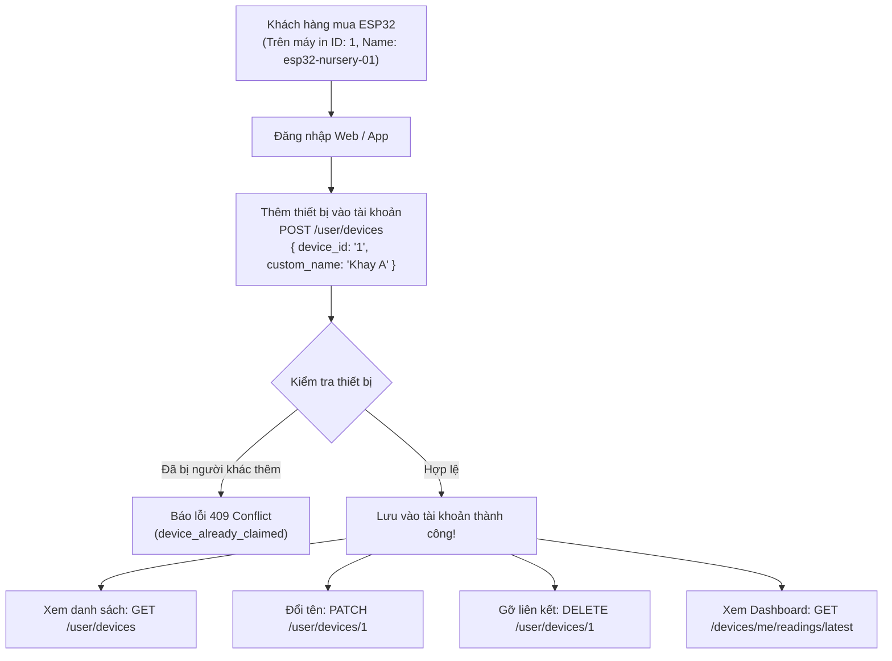

# Hướng dẫn Tích hợp API Backend dành cho Frontend Web (DKhoa) & Mobile App (QThang)

**Dự án:** MVP Hệ thống Chăm sóc Vườn ươm Ớt con bằng IoT (`pepper-nursery-iot`)  
**Người phụ trách Backend:** TDat  
**Người sử dụng API:** DKhoa (Web Dashboard), QThang (Mobile App Flutter)  
**Phiên bản API:** `v1` (Cập nhật ngày 10/11/2026: Luồng Quản lý Thiết bị Thực tế $1 \text{ User} \rightarrow N \text{ Devices}$)  
**Tình trạng:** Sẵn sàng kết nối, có CORS whitelist, 100% Integration Tests Passing  

---

## 1. Vị trí Các Tài liệu API & Đặc tả Kỹ thuật trong Dự án

Dành cho DKhoa và QThang khi cần tra cứu các tài liệu API trong repo:

| Tên File | Đường dẫn | Mục đích sử dụng |
| :--- | :--- | :--- |
| **API Contract G0** | [`docs/contracts/api.md`](file:///c:/Work/School/Y4-HK1/IoT/src/pepper-nursery-iot/docs/contracts/api.md) | Bản hợp đồng thiết kế gốc (chuẩn G0 v0.1) giữa Backend, Firmware và Frontend. |
| **Tài liệu Toàn diện Endpoints** | [`API_ENDPOINTS.md`](file:///c:/Work/School/Y4-HK1/IoT/src/pepper-nursery-iot/API_ENDPOINTS.md) | Bảng đặc tả kỹ thuật chi tiết toàn bộ các API của hệ thống (Auth, Channels, Feeds, Range, Telemetry, mã lỗi HTTP). |
| **Hướng dẫn Tích hợp Frontend/Mobile** | [`docs/contracts/huong-dan-tich-hop-frontend-mobile.md`](file:///c:/Work/School/Y4-HK1/IoT/src/pepper-nursery-iot/docs/contracts/huong-dan-tich-hop-frontend-mobile.md) *(file này)* | Bản hướng dẫn tích hợp thực chiến dành riêng cho Web & App, kèm sơ đồ luồng, code mẫu JavaScript/Dart, state machine và xử lý lỗi. |

---

> Cập nhật 11/11/2026: phần luồng tài khoản trong [api.md](api.md#luồng-người-dùng-cuối-mobile) là hợp đồng hiện hành. Mobile chỉ gọi backend dự án. Nhận thiết bị dùng **device ID chính xác**, không dùng tên; mã không tồn tại trả 404, không tự tạo thiết bị. Tất cả API đọc thiết bị/số đo yêu cầu JWT và kiểm tra chủ sở hữu. Các ví dụ cũ dưới đây cần đọc theo các quy tắc này.

## 2. Địa chỉ Máy chủ (Base URL) & Hạ tầng Kết nối

* **Backend TDat Production (Render):** `https://pepper-nursery-iot.onrender.com/api/v1`
* **Local Development:** `http://localhost:8000/api/v1`
* **Kiểm tra trạng thái máy chủ:** `GET https://pepper-nursery-iot.onrender.com/api/v1/health`
* **Sensor Data Bridge:** `https://sensor-data-bridge-backend.onrender.com/api/v1` (Channel 1, Read Key: `sdb_read_eqQ-gZ5w8NeWaDoWQbXitJa-FAemYtcKwC34BHMwKnw`)

> [!NOTE]
> Backend đã được cấu hình **CORS Whitelist** cho Web Dashboard trên Render: `https://pepper-nursery-iot-em0t.onrender.com` và localhost (`localhost:3000`, `localhost:5173`, `127.0.0.1`). Gọi fetch/axios từ trình duyệt sẽ không bao giờ bị lỗi Cross-Origin.

---

## 3. Luồng Thực tế: Quản lý Thiết bị ESP32 theo Tài khoản ($1 \text{ User} \rightarrow N \text{ Devices}$)

### 3.1. Nguyên tắc Nghiệp vụ Cốt lõi
1. **Mã in trên thiết bị phần cứng:** Mỗi thiết bị ESP32 khi xuất xưởng/mua về đều có in sẵn mã `id` (ví dụ: `1`) hoặc `name` (ví dụ: `esp32-nursery-01`).
2. **Sở hữu độc quyền:** Mỗi thiết bị **chỉ liên kết với DUY NHẤT 1 tài khoản** tại một thời điểm (`owner_id`). Nếu tài khoản khác cố tình thêm, hệ thống sẽ chặn và trả về lỗi `409 Conflict` (`device_already_claimed`).
3. **Một tài khoản có nhiều thiết bị ($1 \rightarrow N$):** Một người dùng có thể mua và thêm nhiều trạm vườn ươm vào tài khoản của mình.
4. **Quyền thao tác của người dùng:**
   - **Thêm thiết bị:** Nhập mã in trên máy để gắn vào tài khoản, có thể đặt tên hiển thị riêng (ví dụ: *"Vườn ươm ớt Khay A"*).
   - **Sửa tên hiển thị:** Đổi tên trạm đo bất cứ lúc nào trên web/app.
   - **Xóa thiết bị:** Gỡ liên kết thiết bị khỏi tài khoản. Sau khi gỡ, thiết bị trở về trạng thái tự do để tài khoản khác có thể thêm lại.
   - **Chuyển trạm đang xem (Active Device):** Chuyển đổi qua lại giữa các trạm để Dashboard hiển thị số đo tương ứng.



---

## 4. Danh mục API Quản lý Thiết bị cho Tài khoản (`/user/devices`)

Tất cả các API trong mục này đều yêu cầu header: `Authorization: Bearer <JWT_TOKEN>`.

### 4.1. Bảng Tra cứu Nhanh

| Chức năng | Method | Endpoint | Request Body | Phản hồi chính |
| :--- | :---: | :--- | :--- | :--- |
| **Thêm thiết bị** | `POST` | `/user/devices` | `{ device_id, custom_name }` | `201 Created` kèm thông tin thiết bị đã gán |
| **Xem danh sách thiết bị** | `GET` | `/user/devices` | Không | `200 OK` mảng thiết bị, trạng thái `is_online`, số đo |
| **Đổi tên hiển thị** | `PATCH` | `/user/devices/:id` | `{ name: "Tên mới" }` | `200 OK` kèm thiết bị đã đổi tên |
| **Xóa thiết bị** | `DELETE`| `/user/devices/:id` | Không | `200 OK`, gỡ liên kết khỏi tài khoản |
| **Chọn trạm xem mặc định** | `PUT` | `/user/devices/:id/active` | Không | `200 OK`, đổi `active_device_id` cho Dashboard |
| **Số đo trạm đang chọn** | `GET` | `/devices/me/readings/latest` | Không | `200 OK` số đo + advice của trạm đang active |
| **Lọc số đo theo ngày** | `GET` | `/devices/me/readings/range` | `?start_date=...&end_date=...` | `200 OK` lọc số đo theo khoảng thời gian |

---

### 4.2. Chi tiết Request & Response

#### 1. Thêm thiết bị vào tài khoản: `POST /api/v1/user/devices`
* **Request Body:**
  ```json
  {
    "device_id": "1",
    "custom_name": "Vườn ươm ớt Khay A"
  }
  ```
  *(Trường `device_id` chấp nhận cả số `1` hoặc mã `esp32-nursery-01` in trên thiết bị)*
* **Response (201 Created):**
  ```json
  {
    "status": "ok",
    "message": "Thêm thiết bị vào tài khoản thành công",
    "device": {
      "device_id": "1",
      "name": "Vườn ươm ớt Khay A",
      "description": "Trạm vườn ươm ớt (Sensor Data Bridge Channel 1)",
      "is_online": true,
      "latest_reading": {
        "air_temperature_c": 32.7,
        "air_humidity_pct": 69.5,
        "soil_temperature_c": 32.0,
        "soil_moisture_pct": 45.0,
        "water_ph": 6.2,
        "water_tds_ppm": 580.0
      }
    }
  }
  ```
* **Lỗi đã có chủ sở hữu (409 Conflict):**
  ```json
  {
    "error": {
      "code": "device_already_claimed",
      "message": "Thiết bị này đã được liên kết với một tài khoản khác. Mỗi thiết bị chỉ liên kết với 1 tài khoản."
    }
  }
  ```

---

#### 2. Lấy danh sách thiết bị của tài khoản: `GET /api/v1/user/devices`
* **Response (200 OK):**
  ```json
  {
    "status": "ok",
    "active_device_id": "1",
    "total": 2,
    "devices": [
      {
        "device_id": "1",
        "name": "Vườn ươm ớt Khay A",
        "description": "Trạm vườn ươm ớt (Sensor Data Bridge Channel 1)",
        "created_at": "2026-11-10T10:00:00.000Z",
        "is_active": true,
        "is_online": true,
        "latest_reading": {
          "air_temperature_c": 32.7,
          "air_humidity_pct": 69.5,
          "soil_temperature_c": 32.0,
          "soil_moisture_pct": 45.0,
          "water_ph": 6.2,
          "water_tds_ppm": 580.0
        },
        "latest_advice": {
          "status": "optimal",
          "message": "Môi trường vườn ươm đang ở điều kiện lý tưởng"
        }
      },
      {
        "device_id": "esp32-nursery-02",
        "name": "Vườn ươm ớt Khay B",
        "description": "Trạm khuếch tán sương",
        "created_at": "2026-11-10T11:00:00.000Z",
        "is_active": false,
        "is_online": false,
        "latest_reading": null,
        "latest_advice": null
      }
    ]
  }
  ```

---

#### 3. Sửa tên hiển thị của thiết bị: `PATCH /api/v1/user/devices/:device_id`
* **Request Body:**
  ```json
  {
    "name": "Vườn ươm ớt Siêu Cay Khay 1"
  }
  ```
* **Response (200 OK):**
  ```json
  {
    "status": "ok",
    "message": "Cập nhật tên thiết bị thành công",
    "device": {
      "device_id": "1",
      "name": "Vườn ươm ớt Siêu Cay Khay 1"
    }
  }
  ```

---

#### 4. Xóa thiết bị khỏi tài khoản (Gỡ liên kết): `DELETE /api/v1/user/devices/:device_id`
* **Response (200 OK):**
  ```json
  {
    "status": "ok",
    "message": "Đã xóa thiết bị khỏi tài khoản thành công",
    "remaining_devices_count": 1,
    "active_device_id": "esp32-nursery-02"
  }
  ```

---

#### 5. Chọn trạm hiển thị mặc định cho Dashboard: `PUT /api/v1/user/devices/:device_id/active`
* **Response (200 OK):**
  ```json
  {
    "status": "ok",
    "message": "Đã chuyển thiết bị hiển thị mặc định",
    "active_device_id": "1"
  }
  ```

---

#### 6. Lấy số đo mới nhất của trạm đang chọn: `GET /api/v1/devices/me/readings/latest`
* Backend tự động phân tích và trả về số đo + Lời khuyên nông học 5 phân vùng (`advice`):
```json
{
  "device_id": "1",
  "name": "Vườn ươm ớt Khay A",
  "received_at": "2026-11-10T11:36:56.000Z",
  "is_stale": false,
  "reading": {
    "schema_version": "0.1",
    "device_id": "1",
    "sample_id": "sdb-entry-484",
    "recorded_at": "2026-11-10T11:36:56.000Z",
    "air_temperature_c": 25.0,
    "air_humidity_pct": 54.7,
    "soil_temperature_c": 23.19,
    "soil_moisture_pct": 0.0,
    "soil_moisture_raw": 4086,
    "water_ph": 4.21,
    "water_ph_adc_raw": 925,
    "water_tds_ppm": 58.5,
    "sensor_status": {
      "dht22": "ok",
      "ds18b20": "ok",
      "hd38": "ok",
      "tds": "ok",
      "ph4502c": "ok"
    }
  },
  "advice": {
    "version": "0.1",
    "status": "danger",
    "priority": 2,
    "code": "RULE_PH_EXTREME_LOW",
    "message": "Nước tưới cực chua (Axit nặng): Tuyệt đối không tưới! Dùng nước vôi trong nâng pH lên 6.0-6.5.",
    "suggested_action": "Tuyệt đối không tưới! Dùng nước vôi trong nâng pH lên 6.0-6.5."
  }
}
```

---

## 5. Code Mẫu Tích hợp Toàn diện (JavaScript & Flutter)

### 5.1. Dành cho Web Frontend (DKhoa - JavaScript / ES Module)
Tạo file `src/services/deviceService.js`:
```javascript
const BASE_URL = 'https://pepper-nursery-iot.onrender.com/api/v1';

function authHeaders() {
  const token = localStorage.getItem('token');
  return {
    'Content-Type': 'application/json',
    'Authorization': `Bearer ${token}`
  };
}

// 1. Lấy danh sách tất cả thiết bị của tài khoản
export async function getMyDevices() {
  const res = await fetch(`${BASE_URL}/user/devices`, { headers: authHeaders() });
  if (!res.ok) throw new Error('Không thể tải danh sách thiết bị');
  return await res.json(); // { total, active_device_id, devices: [...] }
}

// 2. Thêm thiết bị mới vào tài khoản (nhập mã in trên máy)
export async function addDeviceToAccount(deviceId, customName = '') {
  const res = await fetch(`${BASE_URL}/user/devices`, {
    method: 'POST',
    headers: authHeaders(),
    body: JSON.stringify({ device_id: deviceId, custom_name: customName })
  });
  if (res.status === 409) {
    throw new Error('Thiết bị này đã có người khác liên kết!');
  }
  if (!res.ok) throw new Error('Không thể thêm thiết bị');
  return await res.json();
}

// 3. Sửa tên hiển thị của thiết bị
export async function renameDevice(deviceId, newName) {
  const res = await fetch(`${BASE_URL}/user/devices/${deviceId}`, {
    method: 'PATCH',
    headers: authHeaders(),
    body: JSON.stringify({ name: newName })
  });
  if (!res.ok) throw new Error('Đổi tên thiết bị thất bại');
  return await res.json();
}

// 4. Xóa thiết bị khỏi tài khoản (gỡ liên kết)
export async function removeDevice(deviceId) {
  const res = await fetch(`${BASE_URL}/user/devices/${deviceId}`, {
    method: 'DELETE',
    headers: authHeaders()
  });
  if (!res.ok) throw new Error('Gỡ thiết bị thất bại');
  return await res.json();
}

// 5. Chuyển thiết bị đang xem mặc định
export async function setActiveDevice(deviceId) {
  const res = await fetch(`${BASE_URL}/user/devices/${deviceId}/active`, {
    method: 'PUT',
    headers: authHeaders()
  });
  if (!res.ok) throw new Error('Chuyển thiết bị thất bại');
  return await res.json();
}

// 6. Lấy số đo thời gian thực của trạm đang active để vẽ Dashboard
export async function getLiveTelemetry() {
  const res = await fetch(`${BASE_URL}/devices/me/readings/latest`, {
    headers: authHeaders()
  });
  if (!res.ok) throw new Error('Lỗi tải số đo thời gian thực');
  return await res.json();
}
```

---

### 5.2. Dành cho Mobile App (QThang - Flutter / Dart)
Tạo file `lib/services/user_device_service.dart`:
```dart
import 'dart:convert';
import 'package:http/http.dart' as http;

class UserDeviceService {
  static const String baseUrl = 'https://pepper-nursery-iot.onrender.com/api/v1';
  static String? token;

  static Map<String, String> get _headers => {
    'Content-Type': 'application/json',
    if (token != null) 'Authorization': 'Bearer $token',
  };

  // 1. Tải danh sách thiết bị của tài khoản
  static Future<Map<String, dynamic>> fetchMyDevices() async {
    final res = await http.get(Uri.parse('$baseUrl/user/devices'), headers: _headers);
    if (res.statusCode == 200) return jsonDecode(res.body);
    throw Exception('Lỗi tải danh sách thiết bị');
  }

  // 2. Thêm thiết bị mới vào tài khoản
  static Future<Map<String, dynamic>> claimDevice(String deviceId, {String? customName}) async {
    final res = await http.post(
      Uri.parse('$baseUrl/user/devices'),
      headers: _headers,
      body: jsonEncode({
        'device_id': deviceId,
        if (customName != null) 'custom_name': customName,
      }),
    );
    if (res.statusCode == 409) {
      throw Exception('Thiết bị này đã được liên kết với một tài khoản khác!');
    }
    if (res.statusCode == 201 || res.statusCode == 200) {
      return jsonDecode(res.body);
    }
    throw Exception('Không thể thêm thiết bị');
  }

  // 3. Đổi tên hiển thị thiết bị
  static Future<void> renameDevice(String deviceId, String newName) async {
    final res = await http.patch(
      Uri.parse('$baseUrl/user/devices/$deviceId'),
      headers: _headers,
      body: jsonEncode({'name': newName}),
    );
    if (res.statusCode != 200) throw Exception('Đổi tên thất bại');
  }

  // 4. Xóa thiết bị khỏi tài khoản
  static Future<void> removeDevice(String deviceId) async {
    final res = await http.delete(
      Uri.parse('$baseUrl/user/devices/$deviceId'),
      headers: _headers,
    );
    if (res.statusCode != 200) throw Exception('Xóa thiết bị thất bại');
  }

  // 5. Lấy số đo trạm active
  static Future<Map<String, dynamic>> fetchLiveReading() async {
    final res = await http.get(
      Uri.parse('$baseUrl/devices/me/readings/latest'),
      headers: _headers,
    );
    if (res.statusCode == 200) return jsonDecode(res.body);
    throw Exception('Lỗi tải số đo trạm đang xem');
  }
}
```

---

## 6. Bảng Mã Lỗi HTTP & Hướng Dẫn Xử Lý (Error Handling)

| Mã HTTP | Mã lỗi (`error.code`) | Nguyên nhân | Hướng xử lý ở Frontend / Mobile |
| :---: | :--- | :--- | :--- |
| **`200`** | - | Thành công | Parse JSON và render giao diện. |
| **`201`** | - | Thêm thiết bị thành công | Đóng modal, hiển thị Toast xanh và reload danh sách. |
| **`400`** | `missing_device_id` / `missing_name` | Chưa nhập mã thiết bị hoặc để trống tên | Hiển thị thông báo kiểm tra lại ô nhập liệu. |
| **`401`** | `unauthorized` | Chưa đăng nhập hoặc token hết hạn | Điều hướng về trang Đăng nhập. |
| **`403`** | `forbidden` | Thao tác trên thiết bị không thuộc tài khoản mình | Thông báo *"Bạn không có quyền sửa/xóa thiết bị này"*. |
| **`404`** | `device_not_found` | Mã thiết bị không tồn tại | Báo người dùng kiểm tra lại mã in trên máy. |
| **`409`** | `device_already_claimed` | **Thiết bị đã gắn với tài khoản khác** | **Hiển thị thông báo đỏ:** *"Thiết bị này đã có người khác liên kết. Vui lòng liên hệ hỗ trợ kỹ thuật hoặc gỡ thiết bị khỏi tài khoản cũ!"* |
| **`500`** | `server_error` | Sự cố server tạm thời | Báo hệ thống bảo trì và retry sau ít giây. |

---
**Hỗ trợ kỹ thuật:** Nếu DKhoa hoặc QThang gặp bất kỳ vướng mắc gì trong quá trình gắn API, hãy liên hệ trực tiếp TDat để được hỗ trợ kiểm tra logs!
